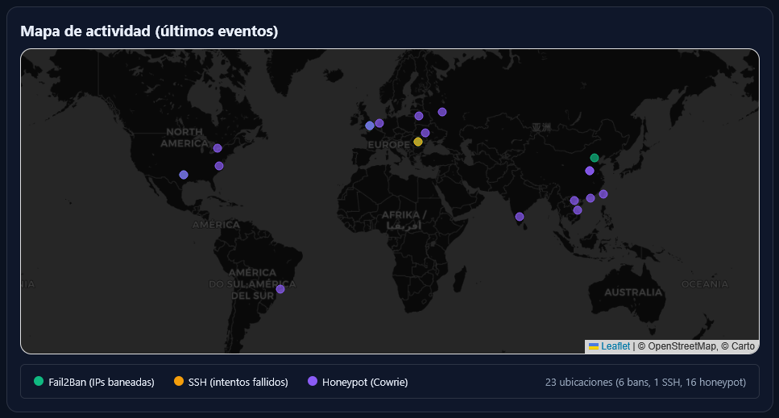
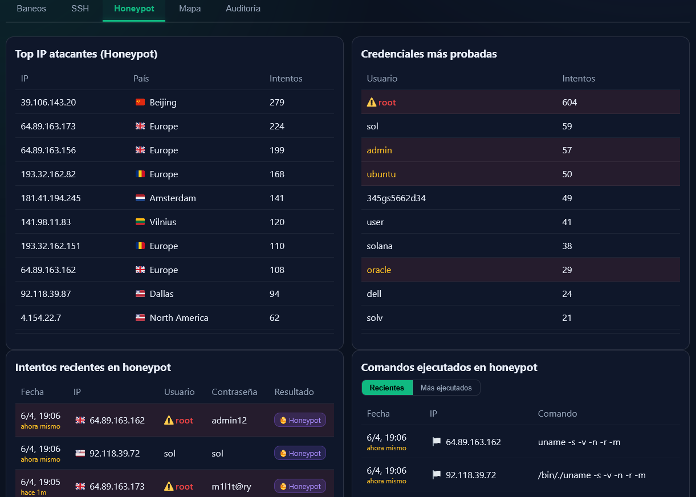
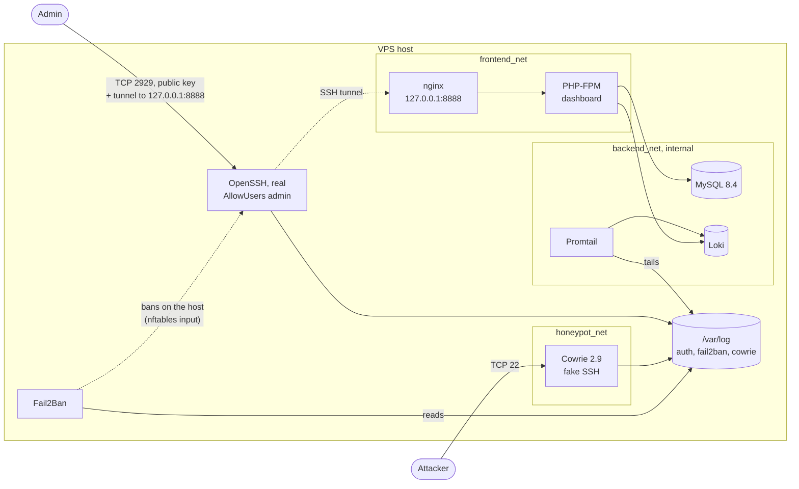

# ASIR VPS Defense

A defended Linux VPS. A **Cowrie SSH honeypot on port 22** lets attackers "log in" and records their credentials, commands and sessions, while the **real SSH runs on another port and accepts only the admin's public key**. Fail2Ban turns honeypot activity into bans on the real host, Promtail and Loki collect every log, and a **private dashboard is reachable only through an SSH tunnel**. One Bash installer sets it all up with Docker Compose.

Final project of the Spanish higher vocational degree in Network and Systems Administration (*ASIR*), 2025–2026, by Pau Ginesta.



<sub>Dashboard map with live data from the VPS, April 2026 (v2.1.0, Spanish UI).</sub>

## What it does

| | |
|---|---|
| **Deceive** | Cowrie answers on port 22 as an Ubuntu server, accepts any password and records logins, commands and full TTY sessions. |
| **Protect** | The real OpenSSH listens on port 2929 (configurable) for one account, with public keys only. |
| **Respond** | Fail2Ban bans repeat offenders on the real SSH, and blocks anyone who keeps hitting the honeypot from the rest of the host. |
| **Observe** | Promtail ships `auth.log`, `fail2ban.log` and Cowrie's text and JSON logs to Loki; a PHP dashboard shows bans, SSH attempts, honeypot credentials and commands, a map and an audit log. |



<sub>Honeypot tab after a few days online (v2.1.0, Spanish UI): 604 attempts as `root`, credentials tried by bots, and the commands they ran once "inside".</sub>

## Architecture



- **Port 22** is published by Docker and forwarded to Cowrie. **Port 2929** is the host's OpenSSH. Nothing else is reachable from the Internet: UFW denies incoming traffic, and the dashboard binds to `127.0.0.1`.
- Cowrie sits alone on its own network. If the honeypot were compromised, it could not reach nginx, PHP-FPM, MySQL or Loki.
- MySQL and Loki live on an internal network with no route out and no published ports.

## Design decisions

- **The honeypot owns port 22.** That is where bots knock, so that is where the telemetry is. The real SSH moves to another port and accepts nothing but the admin's key: there is no password to guess.
- **Ban from the host, not from the honeypot.** An IP that makes 5 connections to Cowrie in 10 minutes is a known attacker. Fail2Ban blocks it from every port of the real host for 7 days with an nftables *input* rule, but Docker forwards port 22 to Cowrie through the *forward* path, so the attacker keeps reaching the honeypot and keeps producing data.
- **The dashboard is never exposed.** It listens on loopback only, and the admin reaches it through the same SSH connection used to manage the server. The real SSH allows local forwards (`-L`) and nothing else.
- **Validate before applying.** The installer writes `sshd_config` to a temporary file, checks it with `sshd -t`, and only then replaces the live one; Fail2Ban's configuration is checked with `fail2ban-client -t` before restarting. A broken config never locks the admin out.
- **No secrets in `.env`.** MySQL passwords are Docker secrets (files readable only by root or by the consuming container); the dashboard credentials are encrypted with [age](https://age-encryption.org) to the admin's SSH public key.

## Security controls

| Area | Control |
|---|---|
| Real SSH | `AllowUsers <admin>`, public key only, no root, `MaxAuthTries 1`, local forwarding only, post-quantum hybrid key exchange first (`mlkem768x25519` or `sntrup761x25519`, whichever the installed OpenSSH supports). Drop-ins in `sshd_config.d/` are ignored, so cloud-init cannot re-enable passwords. |
| Fail2Ban | `sshd` jail: 2 failed attempts in 10 min → 35-day ban on the SSH port; the admin's own failed keys do not count. `cowrie` jail: 5 connections in 10 min → 7-day ban from every host port, honeypot still reachable. |
| Honeypot | Cowrie 2.9.0, own network, all capabilities dropped, `no-new-privileges`, memory and PID limits. |
| Dashboard | Loopback only, behind the SSH tunnel; bcrypt passwords, CSRF token, session cookie `HttpOnly` + `SameSite=Strict`, 8-hour session limit, login rate limit in nginx, audit log. Everything that comes from logs (usernames tried by attackers included) is escaped; scripts run only with a per-request CSP nonce, and Leaflet is loaded with Subresource Integrity. |
| Containers | `no-new-privileges` on all; the PHP container is read-only, non-root and has no capabilities; image versions are pinned. |
| Data | Loki keeps 31 days. `backups.sh` makes cold backups of MySQL plus configuration and honeypot sessions, with rotation and scheduling; a restore reports any step that fails instead of claiming success. |

## Requirements

- A VPS with a public IPv4 address and **Debian 12**, where the project was deployed. Debian 13 and Ubuntu 22.04 / 24.04 are expected to work but have not been tested end to end.
- Root access, and an SSH key pair on your computer.
- Free space for Docker images and a dedicated disk or 20 GB for backups (a loop file is created if there is no spare disk).

## Installation

On a fresh server, from a session you can keep open, one command:

```bash
curl -fsSL https://raw.githubusercontent.com/paulusgi/asir-vps-defense/v3.0.2/deploy.sh | sudo bash
```

The URL points to a release tag, not to a branch, and the installer then fetches the project files of that same release: what runs is exactly the published v3.0.2. Its questions are read from the terminal, so they work through the pipe.

To read the script before it runs as root:

```bash
git clone --branch v3.0.2 https://github.com/paulusgi/asir-vps-defense.git
cd asir-vps-defense
less deploy.sh
sudo ./deploy.sh
```

The installer is interactive and can be re-run: completed steps are recorded and skipped. It asks for the real SSH port (default 2929), the admin's user name, sudo password and public key, and the key used to encrypt the dashboard credentials. Then it:

1. installs Docker, UFW, Fail2Ban and rsyslog, and closes every incoming port except 22;
2. creates the admin, moves the real SSH to the new port (validated with `sshd -t`), and configures Fail2Ban;
3. puts the project in the admin's home: the files next to the script, or the matching release from GitHub when the script came through `curl`;
4. generates secrets, downloads the GeoLite2 City database (pinned and checksum-verified) and starts the containers;
5. prepares the backup volume and offers a first backup.

Before closing the installer's session, **open a new terminal and check that you can log in** with `ssh -p 2929 <admin_user>@<server-ip>`.

### Upgrading

Run the one-command install of the new release on the server, as the admin (`sudo` asks for its password). On a finished installation it does not reinstall anything: it updates the project files (dashboard, configuration, scripts) to that release, keeps the secrets, `.env`, the GeoIP database and every data volume, and restarts only the containers whose files changed. The SSH, Fail2Ban and firewall set-up of the host is left as it is.

## Using it

Open the tunnel and browse to <http://localhost:8888> (any free local port works; the screenshots use 9999):

```bash
ssh -p 2929 -N -L 8888:127.0.0.1:8888 <admin_user>@<server-ip>
```

The dashboard credentials are in `~/admin_credentials.txt.age` on the server, encrypted to your key:

```bash
scp -P 2929 <admin_user>@<server-ip>:admin_credentials.txt.age .
age -d -i ~/.ssh/id_ed25519 admin_credentials.txt.age
```

Backups, from the project folder on the server:

```bash
sudo ./backups.sh                      # interactive menu
sudo ./backups.sh create               # backup now
sudo ./backups.sh schedule 03:30       # daily at 03:30 (weekly and monthly too)
sudo ./backups.sh restore <file>
```

[POSTDEPLOY_CHECKS.md](POSTDEPLOY_CHECKS.md) lists the commands to verify a deployment: ports, containers, SSH settings, jails, firewall rules and the log pipeline.

Fail2Ban does not exempt your own address: two failed logins on the real SSH, or five connections to the honeypot, will ban you too. Test attacks from another address, and keep the provider's console at hand to run `sudo fail2ban-client set sshd unbanip <your-ip>`.

## How it was validated

- **v2.1.0** ran on a Debian 12 VPS exposed to the Internet between March and April 2026. The [evidence](evidence/README.md) folder documents 31 checks with screenshots and logs: listening ports and firewall, real attacks captured by Cowrie, TTY session replays, a controlled Hydra test, Fail2Ban bans, LogQL queries, the dashboard behind the tunnel, and the full attack → log → Loki and attempt → ban paths. Public IPs of the VPS and of the admin's computer are redacted.
- **v3.0**, the current version (v3.0.0; v3.0.1 fixed the one-command install; v3.0.2 added the offline map and in-place upgrades), came out of a review of that deployment: key-only real SSH, a working honeypot jail, an isolated honeypot network, panel hardening and backup fixes (see the commit history). Its changes were tested on Debian 13 (OpenSSH 10, Fail2Ban 1.1): the generated `sshd_config` with `sshd -t` / `sshd -T` and live logins (key accepted; password, unknown user, root and wrong key rejected; `-L` allowed, `-R` refused); the jails with `fail2ban-client -t` and `fail2ban-regex` on real log lines; the dashboard's log parser, login, CSP and GeoIP lookups; the backup and restore paths; the Promtail health check; and `shellcheck` on both scripts. **v3.0.0 has not yet been re-deployed end to end on a VPS**; the screenshots show v2.1.0.

## Limitations

- Promtail is deprecated in favour of Grafana Alloy; Loki and Promtail stay on the 2.9 line, and Cowrie on 2.9.0, until the upgrade is tested.
- The dashboard loads Leaflet from jsDelivr (with SRI). Everything else is local: the world map is drawn from a bundled Natural Earth outline, and geolocation uses the GeoLite2 database on the server.
- Totals come from Loki counts; the "top" tables are built from the most recent events (for example, the last 2,000 honeypot logins).
- Behind the SSH tunnel every request reaches nginx from the Docker gateway, so the audit log's IP column is not meaningful; the SSH logs say who opened the tunnel. Failed logins are recorded without the user name that was tried.
- Cowrie's disguise can be fingerprinted: its banner says Ubuntu, its MOTD Debian.
- There is no alerting yet, and the installer is a single Bash script. An Ansible role would be the natural next step.

## Repository layout

```
deploy.sh               interactive installer (Debian/Ubuntu)
backups.sh              backup, restore and scheduling
docker-compose.yml      Cowrie, nginx, PHP-FPM, MySQL, Loki, Promtail
cowrie/                 honeypot configuration and accept-all user database
fail2ban/filter.d/      filter for Cowrie's log (the jails are written by deploy.sh)
nginx/conf.d/           dashboard server: headers, login rate limit, FastCGI
php/                    PHP-FPM image and settings
src/                    dashboard: index.php and the Loki client and metrics
mysql/init/             database schema
loki/, promtail/        log storage and collection
evidence/               validation screenshots and logs, by block
POSTDEPLOY_CHECKS.md    how to verify a deployment
```

## Responsible use

This project is for learning and defence. A honeypot collects credentials that attackers try, and some of them belong to real people: do not reuse, publish or share them. Run it only on servers you own, and check the law that applies where you deploy it.

## License

[PolyForm Noncommercial 1.0.0](LICENSE): free to use, study and modify for any non-commercial purpose. Commercial use requires the author's permission.

This product includes GeoLite2 data created by MaxMind, available from <https://www.maxmind.com>. The world map outline is [Natural Earth](https://www.naturalearthdata.com) data, in the public domain.
