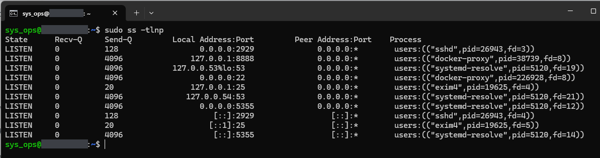
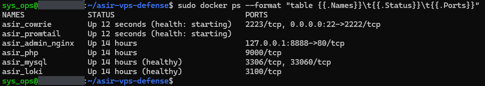
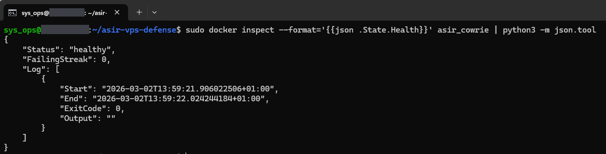
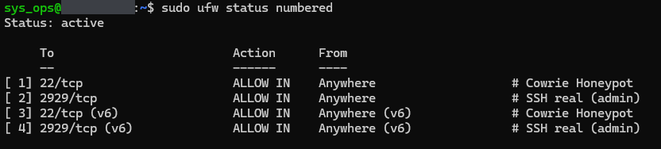
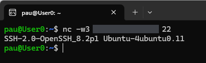

# 01 — Infrastructure

Host and container state: listening ports, containers, the Cowrie health check, firewall rules and the banner on port 22. All captures are from v2.1.0 (see [Version notes](../README.md#version-notes)).

---

## EV-01 — Listening TCP ports

**Shows.** `sudo ss -tlnp` on the host:

- `sshd` on `0.0.0.0:2929` and `[::]:2929`;
- `docker-proxy` on `0.0.0.0:22` (Cowrie) and on `127.0.0.1:8888` (panel);
- `systemd-resolved` on `127.0.0.53%lo:53`, `127.0.0.54:53`, `0.0.0.0:5355` and `[::]:5355`;
- `exim4` on `127.0.0.1:25` and `[::1]:25`.

**Command.**

```bash
sudo ss -tlnp
```

`sudo` is needed for the `Process` column. `-t` lists TCP sockets only.

**What it demonstrates.** Port 22 is held by Docker, which forwards it to Cowrie. The host's OpenSSH listens only on 2929. The panel's port 8888 is bound to the loopback address only.

**Notes.**

- LLMNR (port 5355, `systemd-resolved`) is listening on all interfaces. UFW has no rule for it (EV-04), but no capture in this set tests it from outside. `LLMNR=no` in `/etc/systemd/resolved.conf` would turn it off.
- Port 22 is published on IPv4 only: there is no `[::]:22` line.



---

## EV-02 — Container status

**Shows.** `docker ps` with six containers:

| Container | Status | Ports |
|---|---|---|
| `asir_cowrie` | Up 12 seconds (health: starting) | `2223/tcp`, `0.0.0.0:22->2222/tcp` |
| `asir_promtail` | Up 12 seconds (health: starting) | |
| `asir_admin_nginx` | Up 14 hours | `127.0.0.1:8888->80/tcp` |
| `asir_php` | Up 14 hours | `9000/tcp` |
| `asir_mysql` | Up 14 hours (healthy) | `3306/tcp`, `33060/tcp` |
| `asir_loki` | Up 14 hours (healthy) | `3100/tcp` |

**Command.**

```bash
sudo docker ps --format "table {{.Names}}\t{{.Status}}\t{{.Ports}}"
```

**What it demonstrates.** All six containers are running. MySQL and Loki report `healthy`. Only two ports are published on the host: 22 on all interfaces and 8888 on loopback. The other ports listed (`2223`, `9000`, `3306`, `33060`, `3100`) are exposed by the images to other containers and have no host binding.

**Notes.**

- Cowrie and Promtail had been restarted 12 seconds earlier and their first health check had not run yet, so this capture does not show them healthy. EV-03 shows the Cowrie check passing.
- nginx and PHP-FPM have no health check, so `docker ps` shows no health status for them.



---

## EV-03 — Cowrie health check

**Shows.** The `State.Health` block of `asir_cowrie`: `"Status": "healthy"`, `"FailingStreak": 0`, and a single log entry started at `2026-03-02T13:59:21+01:00` with `"ExitCode": 0` and empty output.

**Command.**

```bash
sudo docker inspect --format='{{json .State.Health}}' asir_cowrie | python3 -m json.tool
```

**What it demonstrates.** Cowrie's health check passed. The check, defined in `docker-compose.yml`, opens a TCP connection from inside the container to `127.0.0.1:2222`, Cowrie's SSH listener. It shows that the port accepts connections, not that Cowrie is logging.

**Notes.**

- There is one entry, not a history: the container had restarted shortly before. Docker keeps the last five results.
- The `+01:00` offset shows the host clock was on CET (UTC+1).
- These checks appear in Cowrie's log as connections from `127.0.0.1` (EV-06, EV-07, EV-28).



---

## EV-04 — UFW rules

**Shows.** UFW is active with four rules: `22/tcp` and `2929/tcp` `ALLOW IN` from anywhere, for IPv4 and IPv6, commented `Cowrie Honeypot` and `SSH real (admin)`. There is no rule for 8888.

**Command.**

```bash
sudo ufw status numbered
```

**What it demonstrates.** Only the honeypot port and the real SSH port are opened in UFW.

**Notes.**

- `status numbered` does not print the default policy. The installer sets `ufw default deny incoming` (`deploy.sh`); the timeout on 8888 in EV-18 and the `filtered` state in EV-27 are consistent with it.
- Docker publishes port 22 with its own NAT and forwarding rules, so traffic to Cowrie does not pass through UFW's input rules. The `22/tcp` rule documents the intent; it is not what lets that traffic in.



---

## EV-05 — SSH banner on port 22

**Shows.** From the admin's workstation, `nc` to port 22 returns `SSH-2.0-OpenSSH_8.2p1 Ubuntu-4ubuntu0.11`.

**Command.**

```bash
nc -w3 <VPS_IP> 22
```

**What it demonstrates.** Port 22 answers with the banner set in `cowrie/cowrie.cfg` (`version = SSH-2.0-OpenSSH_8.2p1 Ubuntu-4ubuntu0.11`). The host's own OpenSSH on 2929 identifies as `OpenSSH 9.2p1 Debian` (EV-27).

**Notes.** The disguise can be fingerprinted. The banner says Ubuntu, but after login Cowrie's fake shell prints a Debian message of the day (EV-09, EV-28), and the same IP runs a Debian OpenSSH on port 2929 (EV-27).


