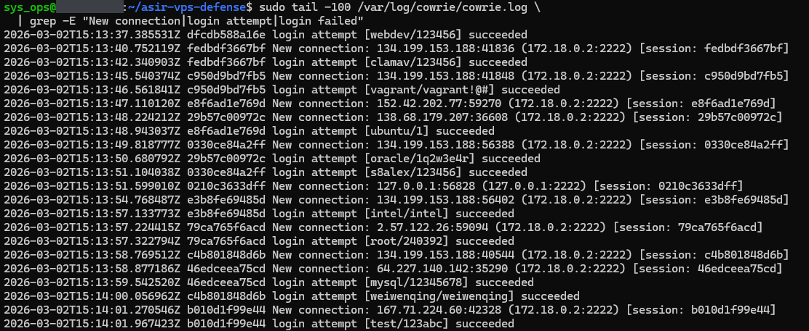
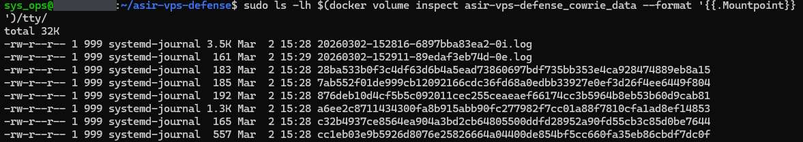
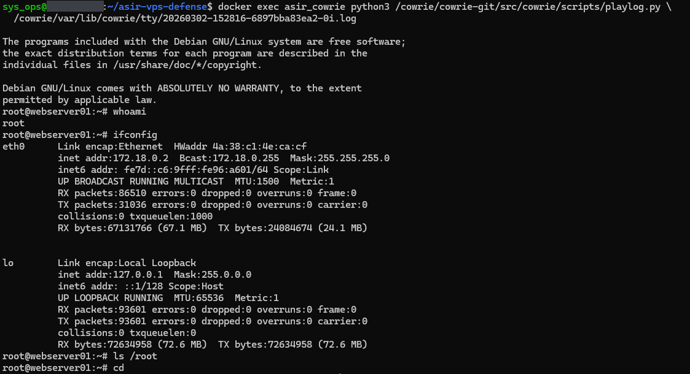
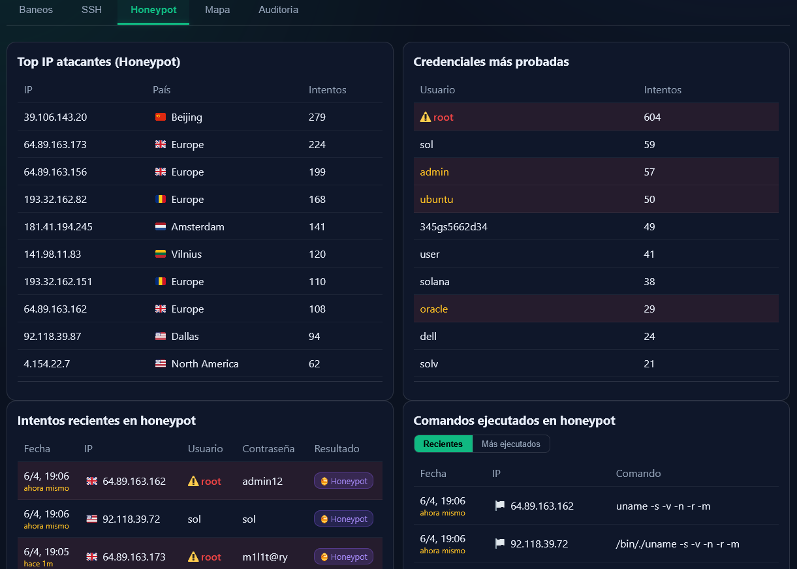

# 02 — Cowrie honeypot

What Cowrie records: connections, login attempts, sessions and commands. Cowrie's user database (`cowrie/userdb.txt`) ends with a wildcard entry, `*:0:*`, so any user name and password is accepted. Cowrie writes its text log in UTC. All captures are from v2.1.0 (see [Version notes](../README.md#version-notes)).

Cowrie's log directory is bind-mounted from the host (`/var/log/cowrie`), so the log can be read on the host without entering the container.

---

## EV-06 — Cowrie log: connections and logins

**Shows.** The end of `/var/log/cowrie/cowrie.log`, 2 March 2026, 15:13:37 to 15:14:01 UTC. Each `New connection` line has the source IP and port, the container's address (`172.18.0.2:2222`) and a session ID. Each `login attempt` line has the session ID, the user/password pair and `succeeded`. Sources include 134.199.153.188, 152.42.202.77, 138.68.179.207, 2.57.122.26, 64.227.140.142 and 167.71.224.60.

**Command.**

```bash
sudo tail -100 /var/log/cowrie/cowrie.log \
  | grep -E "New connection|login attempt|login failed"
```

**What it demonstrates.** Cowrie was receiving connections from Internet hosts and logging every credential pair tried, for example `vagrant/vagrant!@#`, `oracle/1q2w3e4r`, `root/240392`.

**Notes.**

- There are no `login failed` lines because every attempt is accepted.
- The connection from `127.0.0.1` (15:13:51) is the container's own health check (EV-03).



---

## EV-07 — Cowrie log excerpt (text)

**Shows.** [ev07_cowrie_log_excerpt.txt](ev07_cowrie_log_excerpt.txt): the last 30 matching lines of the Cowrie log on 2 March 2026, 15:16:14 to 15:16:42 UTC. There are 16 `New connection` lines (15 from the Internet, 7 of them from 134.199.153.188, and one health check from `127.0.0.1`) and 14 `login attempt ... succeeded` lines, such as `postgres/password`, `ubuntu/1234567` and `root/Zz123456.`.

**Command.**

```bash
sudo grep -E "login attempt|New connection|Command found" \
  /var/log/cowrie/cowrie.log | tail -30
```

**What it demonstrates.** The same as EV-06, as text that can be searched and copied: 15 connections from Internet hosts in under 30 seconds, all logged with their credentials.

**Notes.** The `grep` also matches `Command found`, but none of these 30 lines is a command. Commands run in the honeypot are shown in EV-09, EV-10b and EV-16. The first lines of the file are the shell prompt and the command, with the host name redacted.

---

## EV-08 — Recorded sessions on disk

**Shows.** The `tty/` directory of the `cowrie_data` volume: eight files between 161 bytes and 3.5 KB, dated 2 March, 15:28 to 15:29. Two have a timestamped name ending in `.log` (`20260302-152816-6897bba83ea2-0i.log` and `20260302-152911-89edaf3eb74d-0e.log`); the other six are named by a 64-character hexadecimal string.

**Command.**

```bash
sudo ls -lh $(docker volume inspect asir-vps-defense_cowrie_data --format '{{.Mountpoint}}')/tty/
```

Docker Compose prefixes volume names with the project name, by default the name of the project folder; hence `asir-vps-defense_cowrie_data`.

**What it demonstrates.** Cowrie records interactive sessions to disk, on a named volume that survives container restarts.

**Notes.** These are Cowrie's own session-log files, replayed with `playlog` (EV-09); there are no `.tty` files. In Cowrie 2.x a session's file is renamed to a SHA-256 hash when the session closes, so the six hash-named files are finished sessions and the two `.log` files had not been closed (or not cleanly) when the listing was taken.



---

## EV-09 — Replay of a recorded session

**Shows.** `playlog` replaying `20260302-152816-6897bba83ea2-0i.log`, one of the `.log` files in EV-08. Cowrie's fake shell prints a Debian message of the day and the prompt `root@webserver01:~#`. The commands are `whoami` (answer: `root`), `ifconfig` (a fake `eth0` with `172.18.0.2`, and `lo`), `ls /root` (no output) and `cd`.

**Command.**

```bash
docker exec asir_cowrie python3 /cowrie/cowrie-git/src/cowrie/scripts/playlog.py \
  /cowrie/var/lib/cowrie/tty/20260302-152816-6897bba83ea2-0i.log
```

**What it demonstrates.** A recorded session can be replayed with what was typed and what the fake shell answered.

**Notes.**

- The capture does not show the session's source IP, so it does not establish whether this was an attacker or a manual test.
- The disguise can be fingerprinted. This message of the day says Debian GNU/Linux, while the SSH banner on port 22 says Ubuntu (EV-05, EV-27). `ifconfig` also reports `172.18.0.2`, the container's real Docker address (the same one as in EV-06's `New connection` lines), which hints at a container.



---

## EV-10 — Controlled Hydra test

**Shows.** [ev10_hydra_result.txt](ev10_hydra_result.txt): Hydra 9.5, run from the admin's workstation on 2 March 2026 at 15:34, against port 22 with user `root`, a list of 4 passwords and 4 parallel tasks. Hydra reports all 4 as valid (`test2`, `test`, `password`, `test3`) and finishes within a second.

**Command.**

```bash
hydra -l root -P /tmp/passwords.txt -t 4 -s 22 \
  -o /tmp/hydra_result.txt ssh://<VPS_IP>
```

**What it demonstrates.** Four logins as `root` with four different passwords, all accepted by Cowrie because of the wildcard entry in `userdb.txt`. It is a small controlled test, not a brute-force run.

**Notes.** The Cowrie log lines for these four logins are not part of the evidence; the file is Hydra's own output.

---

## EV-10b — Panel: Honeypot tab

**Shows.** The panel's Honeypot tab on 6 April 2026, around 19:06 (panel time), Spanish UI:

- *Top IP atacantes* (top attacking IPs): 39.106.143.20 with 279 attempts, 64.89.163.173 with 224, 64.89.163.156 with 199, and seven more.
- *Credenciales más probadas* (most tried credentials): user names only, with `root` at 604, then `sol` 59, `admin` 57, `ubuntu` 50, `345gs5662d34` 49.
- *Intentos recientes en honeypot* (recent attempts): date, IP, user, password and result, for example `root` / `admin12` from 64.89.163.162.
- *Comandos ejecutados en honeypot* (commands run): `uname -s -v -n -r -m` from 64.89.163.162 and `/bin/./uname -s -v -n -r -m` from 92.118.39.72.

**How to open it.**

```bash
ssh -N -L 9999:127.0.0.1:8888 -p 2929 <admin_user>@<VPS_IP>
# then browse to http://localhost:9999 and open the "Honeypot" tab
```

**What it demonstrates.** The panel turns Cowrie's JSON log into per-IP counts, user names, passwords and commands. The data come from Loki: `{job="cowrie_json"} |= "cowrie.login."` for logins and `{job="cowrie_json"} |= "cowrie.command.input"` for commands (`src/includes/security_metrics.php`).

**Notes.**

- The *País* (country) column shows a city or a continent, not a country (`Beijing`, `Europe`, `North America`). See the geolocation note under EV-13b.
- In the commands table the IPs carry a generic flag, while the same IPs have country flags in the attempts table.
- The capture is cropped; the rest of each table is not visible.


