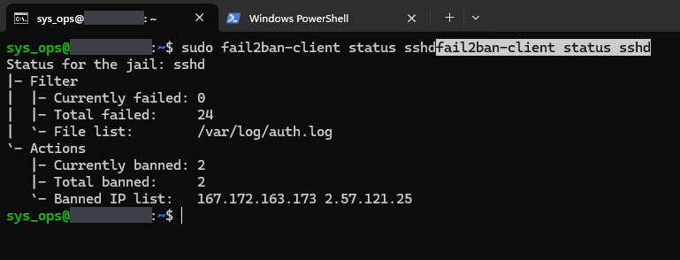
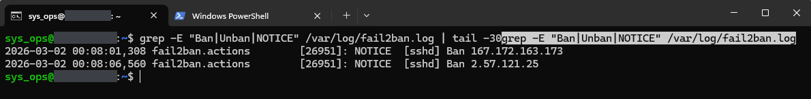
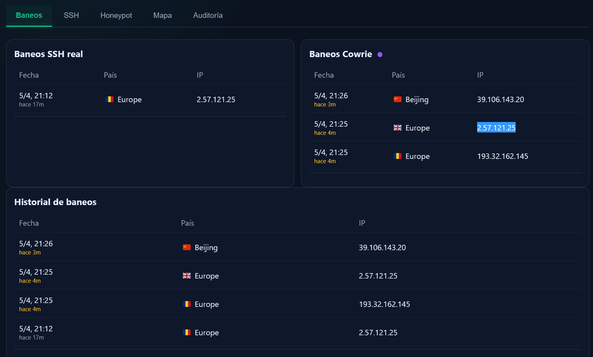

# 03 — Fail2Ban

Bans on the real SSH (jail `sshd`, reading `/var/log/auth.log`) and how the panel shows them. Fail2Ban writes host local time (CET, UTC+1, in March). All captures are from v2.1.0: its `sshd` jail banned after **6** matches in 10 minutes, for 35 days. v3.0.0 bans after 2, and its `cowrie` jail works differently (see [Version notes](../README.md#version-notes)).

---

## EV-11 — Status of the `sshd` jail

**Shows.** For the jail `sshd`: file list `/var/log/auth.log`, `Currently failed: 0`, `Total failed: 24`, `Currently banned: 2`, `Total banned: 2`, banned IPs `167.172.163.173` and `2.57.121.25`.

**Command.**

```bash
sudo fail2ban-client status sshd
```

**What it demonstrates.** The jail was reading `auth.log` and had banned two IPs. They are the two bans of 2 March at 00:08 (EV-12, EV-13): Internet hosts trying to log in to the real SSH on port 2929, not a controlled test.

**Notes.** The command appears twice on the prompt line; the second, highlighted copy is a paste artefact, and the output is that of a single run.



---

## EV-12 — Ban lines in the Fail2Ban log

**Shows.** Two lines, both on 2 March 2026: `00:08:01,308 ... NOTICE [sshd] Ban 167.172.163.173` and `00:08:06,560 ... NOTICE [sshd] Ban 2.57.121.25`.

**Command.**

```bash
grep -E "Ban|Unban|NOTICE" /var/log/fail2ban.log | tail -30
```

**What it demonstrates.** Each ban is logged with its time, the jail, the action and the IP. At the time of the capture these were the only `NOTICE` lines in the log: no other bans and no unbans.

**Notes.** The command appears twice on the prompt line (paste artefact, as in EV-11).



---

## EV-13 — Fail2Ban log excerpt (text)

**Shows.** [ev13_fail2ban_log_excerpt.txt](ev13_fail2ban_log_excerpt.txt): 26 lines from 2 March 2026, 00:08:01 to 00:08:06 host time. There are 24 `[sshd] Found` lines for six IPs and two `[sshd] Ban` lines.

**Command.**

```bash
grep -E "Ban|Found|Restore" /var/log/fail2ban.log | tail -50
```

**What it demonstrates.** How the two bans were reached. `167.172.163.173` has six `Found` lines (attempts from 00:06:59 to 00:07:59) before its ban, and `2.57.121.25` six (00:07:52 to 00:08:05) before its ban, which matches v2.1.0's threshold of 6. The other four IPs had two to four matches each and were not banned. The 24 `Found` lines match `Total failed: 24` in EV-11.

**Notes.**

- These are attempts from the Internet against the real SSH on port 2929, not a controlled test.
- The first 19 `Found` lines all carry a processing time of 00:08:01 but refer to attempts from 00:06:49 onwards: Fail2Ban read them in one pass.
- `tail -50` returned only 26 lines, so these were all the matching lines in the log at the time. None is from the `cowrie` jail.
- The first line of the file is the prompt with the command pasted twice (paste artefact); the host name is redacted.

---

## EV-13b — Panel: Bans tab

**Shows.** The Bans tab (*Baneos*) on 5 April 2026, panel time, with entries 3 to 17 minutes old:

- *Baneos SSH real* (real SSH bans): `2.57.121.25` at 21:12.
- *Baneos Cowrie* (Cowrie-jail bans): `39.106.143.20` at 21:26, `2.57.121.25` and `193.32.162.145` at 21:25.
- *Historial de baneos* (ban history): the same four bans.

**How to open it.**

```bash
ssh -N -L 9999:127.0.0.1:8888 -p 2929 <admin_user>@<VPS_IP>
# then browse to http://localhost:9999, tab "Baneos"
```

**What it demonstrates.** The panel lists the bans Fail2Ban logged, read from Loki (`{job="fail2ban"}`, lines of the form `NOTICE [<jail>] Ban <ip>`), and splits them by jail.

**Notes.**

- **Cowrie-jail bans.** This table has three rows: Fail2Ban logged three `[cowrie]` bans that evening. EV-20, taken a few minutes earlier (21:20), shows the same table empty. The v2.1.0 Cowrie jail read Cowrie's UTC timestamps as local time, which should have kept it from banning anyone; the captures do not show why it fired here. Even when it did fire, a v2.1.0 ban acted on the host's input path, which Docker-forwarded traffic to port 22 does not cross, so it did not stop the IP reaching Cowrie. See [Version notes](../README.md#version-notes), item 3.
- **Geolocation.** The *País* (country) column shows a city (`Beijing`) or a continent (`Europe`) rather than a country. When it parsed the GeoLite2 City record, the v2.1.0 panel took the first English name it found: the city if the record has one, otherwise the continent. The same IP, `2.57.121.25`, also has a Romanian flag in one table and a British flag in another. Treat places and flags in these screenshots as approximate.


