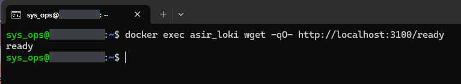
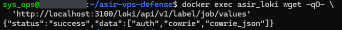
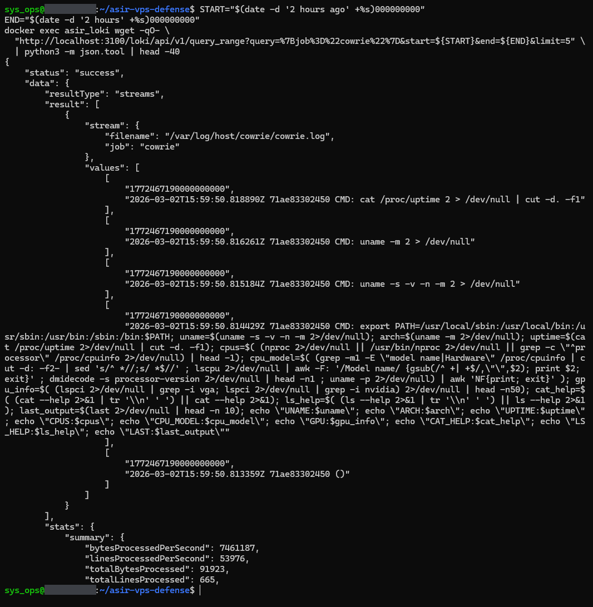
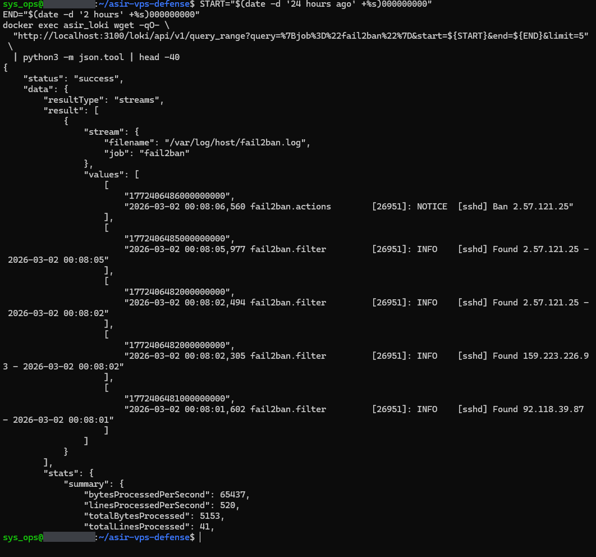

# 04 — Observability (Loki and Promtail)

Promtail reads `auth.log`, `fail2ban.log` and Cowrie's text and JSON logs from the host (mounted at `/var/log/host/` inside the Promtail container) and sends every line to Loki; it does not filter them. Loki's port 3100 is not published on the host (EV-02 shows `3100/tcp` with no host binding), so the queries run inside the Loki container with `docker exec`. All captures are from v2.1.0, which used Loki and Promtail 2.9.2.

## Time zones

- In March the host clock was on CET, UTC+1 (EV-03 shows `+01:00`). Fail2Ban writes host local time, with no offset.
- Cowrie writes UTC, with a trailing `Z`.
- Promtail gives each Loki entry the time written in the log line: read as local time for `fail2ban` and `auth`, as UTC for `cowrie` and `cowrie_json` (`promtail/config.yml`).
- Both are stored correctly in these captures. The Fail2Ban line `2026-03-02 00:08:06,560 ... Ban 2.57.121.25` (CET) has the Loki timestamp `1772406486` s, which is `2026-03-01T23:08:06Z` (EV-17). The Cowrie line `2026-03-02T15:59:50.818890Z` has `1772467190` s, which is `2026-03-02T15:59:50Z` (EV-16).
- The queries below end their window two hours in the future (`END="$(date -d '2 hours' ...)"`). That is a safety margin for a time zone read the wrong way, which would store entries up to an hour or two ahead of the real time and hide them from a window that ends "now". With the timestamps stored correctly, as here, the margin is not needed and `end` can be omitted (Loki then uses the current time).

To convert a Loki timestamp, drop the last nine digits (nanoseconds) and run `date -u -d @1772406486`.

---

## EV-14 — Loki readiness

**Shows.** `ready`.

**Command.**

```bash
docker exec asir_loki wget -qO- http://localhost:3100/ready
```

**What it demonstrates.** Loki had finished starting and reported itself ready to receive and serve data.



---

## EV-15 — Job labels in Loki

**Shows.** Loki's label-values API for the label `job` returns `{"status":"success","data":["auth","cowrie","cowrie_json"]}`.

**Command.**

```bash
docker exec asir_loki wget -qO- \
  'http://localhost:3100/loki/api/v1/label/job/values'
```

**What it demonstrates.** Loki held log lines from three of Promtail's jobs: `auth`, `cowrie` and `cowrie_json`. This is Loki's view of the data it holds, not Promtail's list of targets.

**Notes.** The `fail2ban` job is missing at that moment, although it exists (EV-17 returns its lines). Without a `start` parameter this endpoint only looks at a recent window (the last 6 hours by default), so the most likely reason is that no Fail2Ban line had been ingested in that window.



---

## EV-16 — LogQL query: Cowrie

**Shows.** A `query_range` for `{job="cowrie"}` with `limit=5`. Loki returns one stream (`filename: /var/log/host/cowrie/cowrie.log`, `job: cowrie`) with five lines from session `71ae83302450`, all at 2026-03-02 15:59:50 UTC: `cat /proc/uptime ...`, `uname -m ...`, `uname -s -v -n -m ...`, a long one-liner that collects system information (`uname`, CPU count and model, GPU through `lspci`, `cat --help`, `ls --help`, `last`), and `()`.

**Command.**

```bash
START="$(date -d '2 hours ago' +%s)000000000"
END="$(date -d '2 hours' +%s)000000000"   # 2 h ahead: time-zone margin, see above
docker exec asir_loki wget -qO- \
  "http://localhost:3100/loki/api/v1/query_range?query=%7Bjob%3D%22cowrie%22%7D&start=${START}&end=${END}&limit=5" \
  | python3 -m json.tool | head -40
```

**What it demonstrates.** Cowrie's text log reaches Loki through Promtail and can be queried with LogQL. The commands are those of an automated script profiling the machine inside the honeypot; the source IP is not part of these lines.

**Notes.** The Loki timestamp, `1772467190000000000` ns, is the time in the line, in UTC. `head -40` cuts the output.



---

## EV-17 — LogQL query: Fail2Ban

**Shows.** A `query_range` for `{job="fail2ban"}` over the previous 24 hours, `limit=5`. Loki returns one stream (`filename: /var/log/host/fail2ban.log`, `job: fail2ban`) with the five newest lines: `[sshd] Ban 2.57.121.25` at 00:08:06,560 on 2 March, and the four `[sshd] Found` lines before it.

**Command.**

```bash
START="$(date -d '24 hours ago' +%s)000000000"
END="$(date -d '2 hours' +%s)000000000"   # 2 h ahead: time-zone margin, see above
docker exec asir_loki wget -qO- \
  "http://localhost:3100/loki/api/v1/query_range?query=%7Bjob%3D%22fail2ban%22%7D&start=${START}&end=${END}&limit=5" \
  | python3 -m json.tool | head -40
```

**What it demonstrates.** Fail2Ban's log reaches Loki. Promtail ships every line of the file, not only bans: the `Found` lines come back next to the `Ban`.

**Notes.** The `Ban` line's Loki timestamp, `1772406486` s, is `2026-03-01T23:08:06Z`, the UTC equivalent of the 00:08:06 CET written in the line.


