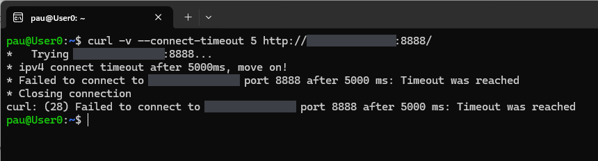
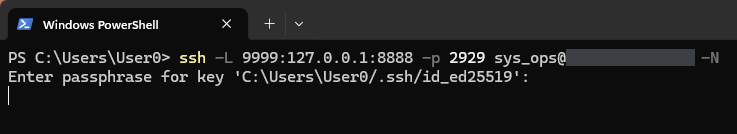
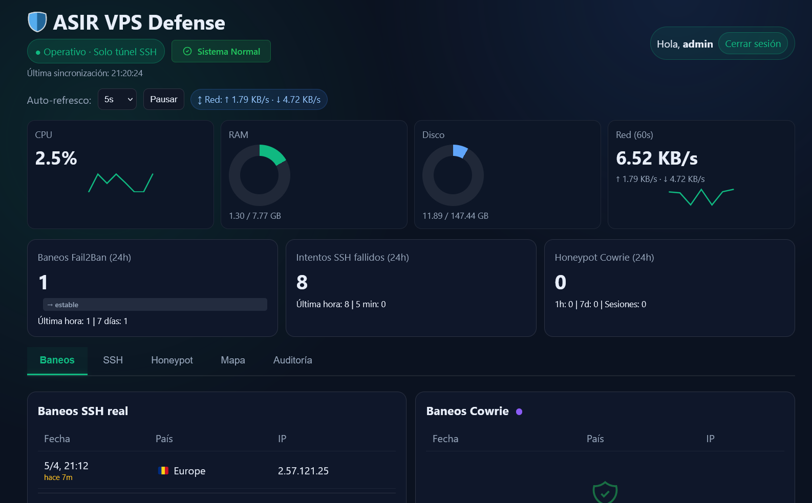
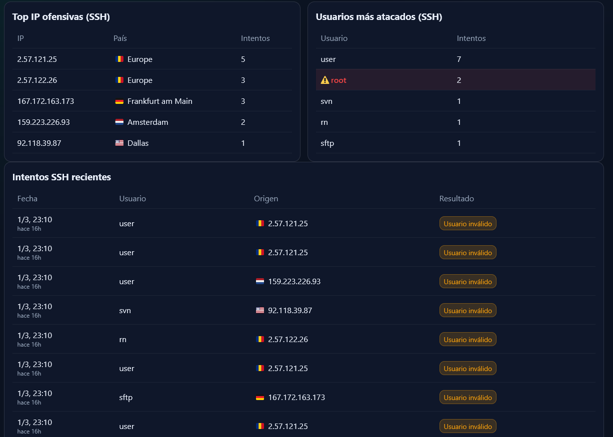
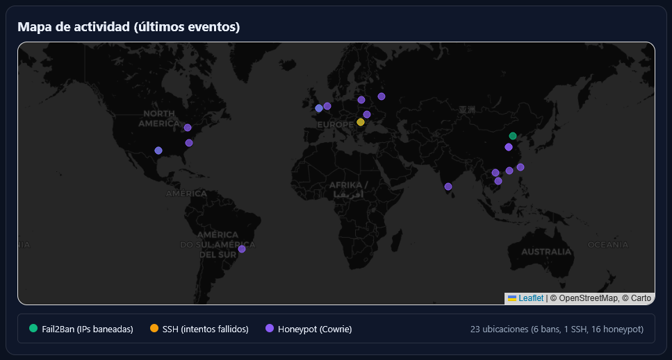
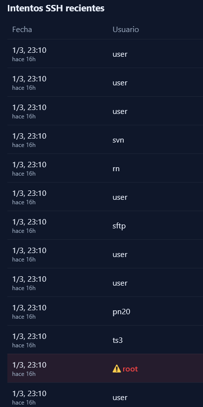
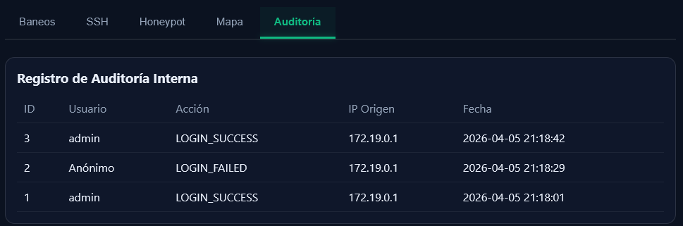

# 05 — Private panel (SSH tunnel)

The panel is served by the `asir_admin_nginx` container, published on the host at `127.0.0.1:8888` only (EV-01, EV-02). The admin reaches it by forwarding a local port over the real SSH connection. All captures are from v2.1.0, whose panel UI was in Spanish (see the glossary in the [evidence README](../README.md#reading-the-captures) and the [Version notes](../README.md#version-notes)).

**Why the panel can only have been reached through the tunnel.** None of the panel screenshots shows the browser's address bar, so the evidence is indirect: port 8888 listens only on the server's loopback (EV-01, EV-02) and gets no answer from outside (EV-18, EV-27), so a browser on the workstation can only reach it through a forward such as the one opened in EV-19.

To open the panel:

```bash
ssh -N -L 9999:127.0.0.1:8888 -p 2929 <admin_user>@<VPS_IP>
# then browse to http://localhost:9999
```

---

## EV-18 — Port 8888 from the Internet

**Shows.** From the admin's workstation, `curl` to port 8888 of the VPS ends with `Failed to connect to <VPS_IP> port 8888 after 5000 ms: Timeout was reached` (curl error 28).

**Command.**

```bash
curl -v --connect-timeout 5 http://<VPS_IP>:8888/
```

**What it demonstrates.** The panel is not reachable from the Internet. The connection timed out rather than being refused: the connection attempt got no answer at all, which is what UFW's default deny (drop) policy does. nginx is in any case bound only to `127.0.0.1` on the host (EV-02). EV-27's `nmap` reports the port as `filtered`, consistent with this.



---

## EV-19 — Opening the tunnel

**Shows.** In Windows PowerShell on the workstation: `ssh -L 9999:127.0.0.1:8888 -p 2929 <admin_user>@<VPS_IP> -N`, followed by the prompt for the passphrase of the local key `id_ed25519`.

**Command.**

```bash
ssh -L 9999:127.0.0.1:8888 -p 2929 <admin_user>@<VPS_IP> -N
```

**What it demonstrates.** How the tunnel is opened: local port 9999 is forwarded to the server's `127.0.0.1:8888`, over the real SSH on port 2929, authenticated with an Ed25519 key. The capture stops at the passphrase prompt, so it shows the tunnel being opened, not that it was up.

**Notes.** With `-N`, ssh runs no remote command and prints nothing once connected; a working tunnel is a silent terminal.



---

## EV-20 — Panel: main dashboard

**Shows.** The dashboard on 5 April 2026, last sync 21:20:24 (panel time), logged in as `admin`:

- host metrics: CPU 2.5 %, RAM 1.30 / 7.77 GB, disk 11.89 / 147.44 GB, network 6.52 KB/s;
- *Baneos Fail2Ban (24h)*: 1;
- *Intentos SSH fallidos (24h)* (failed SSH attempts): 8, all in the last hour;
- *Honeypot Cowrie (24h)*: **0**, with 1 h: 0, 7 days: 0 and sessions: 0;
- the Bans tab: one real-SSH ban (`2.57.121.25`, 21:12, "7 min ago") and an empty Cowrie bans table.

**What it demonstrates.** The dashboard was running and showing host metrics, plus Fail2Ban and SSH counts read from Loki. It does not show honeypot activity: in this capture every Cowrie counter is 0, and the capture does not show why. Honeypot data in the panel is shown in EV-10b (6 April).

**Notes.**

- The green labels *Operativo · Solo túnel SSH* ("Operational · SSH tunnel only") and *Sistema Normal* are page labels, not a measurement of how the page was reached.
- EV-13b, taken a few minutes later the same evening, shows three Cowrie-jail bans in the table that is empty here.



---

## EV-21 — Panel: SSH tab

**Shows.** The SSH tab (the tab bar is outside the crop):

- *Top IP ofensivas (SSH)*: 2.57.121.25 with 5, 2.57.122.26 with 3, 167.172.163.173 with 3, 159.223.226.93 with 2, 92.118.39.87 with 1;
- *Usuarios más atacados (SSH)* (most targeted users): `user` 7, `root` 2, `svn`, `rn` and `sftp` 1 each;
- *Intentos SSH recientes* (recent attempts): date, user, source IP and result. Every visible row is dated 1/3 23:10 ("16 h ago") with the result *Usuario inválido* (invalid user).

**What it demonstrates.** The panel reads failed logins on the **real SSH** from `auth.log` through Loki (in v2.1.0, `{job="auth"} |= "Failed password" |= "sshd["`) and counts them per IP and per user. This is not Cowrie data, and there is no password column: sshd does not log passwords.

**Notes.**

- The IPs are the ones Fail2Ban matched that night (EV-13). The attempts exist because v2.1.0 offered password authentication to every account except the admin (Version notes, item 1).
- The times do not line up exactly. Fail2Ban logged these IPs at 00:06 to 00:08 CET on 2 March, which is 23:06 to 23:08 UTC on 1 March (EV-13); the panel shows 23:10 for all of them. The captures do not show why.



---

## EV-22 — Panel: map

**Shows.** The map tab (*Mapa de actividad*, latest events): a Leaflet map with OpenStreetMap and CARTO tiles. Markers are coloured by source: green for Fail2Ban (banned IPs), orange for SSH (failed attempts), purple for the honeypot (Cowrie). The footer reads *23 ubicaciones (6 bans, 1 SSH, 16 honeypot)*: 23 locations.

**What it demonstrates.** The panel geolocates the IPs of recent events with the local GeoLite2 City database and plots them by source.

**Notes.**

- The capture shows no date.
- Fewer markers can be told apart than the 23 listed (there is one green marker for 6 bans), presumably because markers at the same place overlap.
- Locations are approximate; see the geolocation note under EV-13b.



---

## EV-23 — Panel: recent SSH attempts

**Shows.** A narrow crop of the *Intentos SSH recientes* table from the SSH tab, date and user columns only: 13 rows, all dated 1/3 23:10 ("16 h ago"), with the users `user`, `svn`, `rn`, `sftp`, `pn20`, `ts3` and `root`. `root` is highlighted with a warning icon.

**What it demonstrates.** The same table as in EV-21, with more rows visible. It is a table of recent attempts, not a chart over time.

**Notes.** All the rows show the same minute, so the capture says nothing about how the attempts were spread over time (see the timing note under EV-21).



---

## EV-24 — Panel: audit log

**Shows.** The Audit tab (*Auditoría*), *Registro de Auditoría Interna*: three rows on 2026-04-05. ID 1, `admin`, `LOGIN_SUCCESS` at 21:18:01; ID 2, *Anónimo*, `LOGIN_FAILED` at 21:18:29; ID 3, `admin`, `LOGIN_SUCCESS` at 21:18:42. All three have the source IP `172.19.0.1`.

**What it demonstrates.** Logins to the panel, successful and failed, are written to the MySQL table `audit_log` and shown in the panel.

**Notes.**

- `172.19.0.1` is a Docker bridge gateway address. Behind the SSH tunnel every request reaches nginx through Docker's published port and arrives from the gateway, so the IP column is not meaningful here. The SSH logs show who opened the tunnel.
- The failed login appears as *Anónimo* (anonymous) because v2.1.0 recorded failed logins without the user name that was tried.


