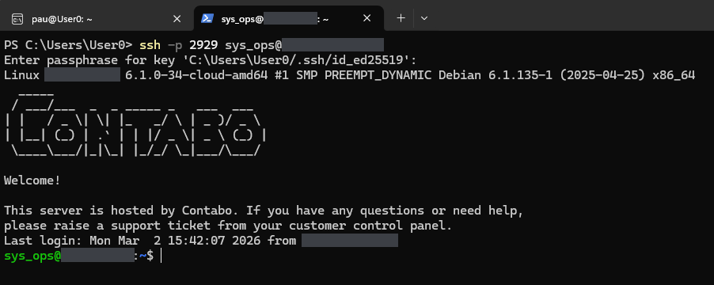
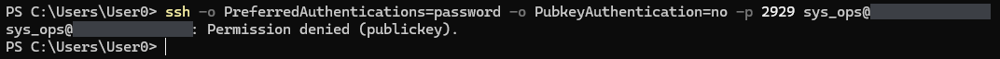
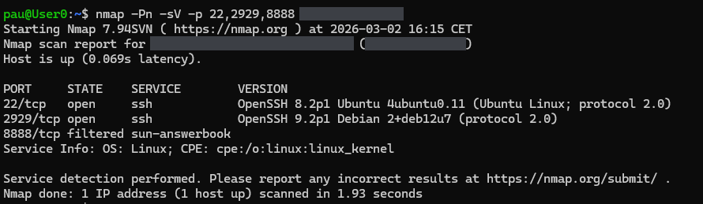

# 06 — Real SSH (port 2929)

The host's OpenSSH on port 2929, compared with Cowrie on port 22. All captures are from v2.1.0. In that version only the admin account was key-only; other user names were still offered password authentication. v3.0.0 allows only the admin to log in, and only with a public key (see [Version notes](../README.md#version-notes), item 1).

---

## EV-25 — Key login as the admin

**Shows.** From PowerShell, `ssh -p 2929 <admin_user>@<VPS_IP>`. The only prompt is the passphrase of the local key `C:\Users\User0/.ssh/id_ed25519`. Then the server's login text: `Linux <VPS_HOST> 6.1.0-34-cloud-amd64 #1 SMP PREEMPT_DYNAMIC Debian 6.1.135-1 (2025-04-25) x86_64`, the hosting provider's welcome message, `Last login: Mon Mar 2 15:42:07 2026 from <ADMIN_IP>`, and a shell prompt.

**Command.**

```bash
ssh -p 2929 <admin_user>@<VPS_IP>
```

**What it demonstrates.** The admin logs in to the real SSH with a public key, and the server does not ask for a password. The passphrase prompt is the client unlocking its own private key. The kernel string is Debian 12's 6.1 cloud kernel.

**Notes.** In v2.1.0 the key-only rule for this account came from a `Match User` block in `sshd_config` (see EV-26).



---

## EV-26 — Password login refused for the admin

**Shows.** `<admin_user>@<VPS_IP>: Permission denied (publickey).`

**Command.**

```bash
ssh -o PreferredAuthentications=password \
    -o PubkeyAuthentication=no \
    -p 2929 <admin_user>@<VPS_IP>
```

**What it demonstrates.** For the admin account the server offers public-key authentication only: the client asked for a password, and the list of methods the server allowed was `publickey`. On port 22, Cowrie accepts any password.

**Notes.** In v2.1.0 this was per account. For other user names the server still offered `password`: EV-29 shows `Permission denied (password)` for `wronguser` on the same port. v3.0.0 closes that with `AllowUsers <admin_user>`, `AuthenticationMethods publickey` and `PasswordAuthentication no` for everyone.



---

## EV-27 — Service scan of ports 22, 2929 and 8888

**Shows.** From the workstation, on 2026-03-02 at 16:15 CET:

| Port | State | Version reported |
|---|---|---|
| 22/tcp | open | `OpenSSH 8.2p1 Ubuntu 4ubuntu0.11 (Ubuntu Linux; protocol 2.0)` |
| 2929/tcp | open | `OpenSSH 9.2p1 Debian 2+deb12u7 (protocol 2.0)` |
| 8888/tcp | filtered | |

**Command.**

```bash
nmap -Pn -sV -p 22,2929,8888 <VPS_IP>
```

**What it demonstrates.** Two different SSH services on one address: port 22 answers with Cowrie's configured banner, and port 2929 is Debian 12's own OpenSSH. Port 8888 gives no answer from outside.

**Notes.**

- `sun-answerbook`, next to 8888, is only nmap's default name for that port number; nmap did not detect a service there.
- Seen side by side, an Ubuntu banner on 22 and a Debian one on 2929 of the same address are a clue that port 22 is not the real server.


