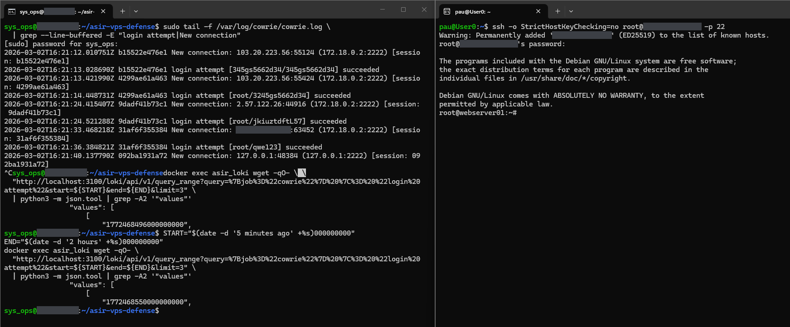
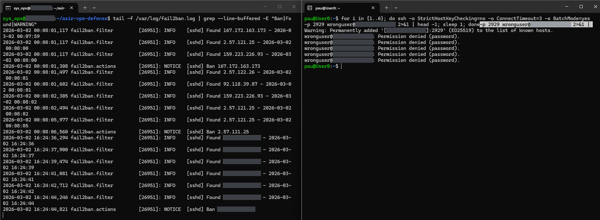

# 07 — End-to-end paths

Two captures that follow one test event through the system: a login to Cowrie, into its log and into Loki (EV-28), and failed SSH attempts, into Fail2Ban's log and a ban (EV-29). Each capture has two terminal windows: the server on the left and the admin's workstation on the right. Both were taken on 2 March 2026 with v2.1.0 (see [Version notes](../README.md#version-notes)).

---

## EV-28 — Login to Cowrie → `cowrie.log` → Loki

**Shows.**

- **Right (workstation):** `ssh -o StrictHostKeyChecking=no root@<VPS_IP> -p 22`, a password prompt, then Cowrie's fake shell with a Debian message of the day and the prompt `root@webserver01:~#`.
- **Left (server):** `tail -f` of the Cowrie log, filtered for logins and connections. On 2 March 2026 at 16:21 UTC it shows connections and logins from 103.20.223.56 and 2.57.122.26, then `New connection: <ADMIN_IP>:63452` at 16:21:33 and, for the same session, `login attempt [root/qwe123] succeeded` at 16:21:36, followed by a health-check connection from `127.0.0.1`.
- **Left, after stopping `tail` with Ctrl+C:** two Loki queries for `{job="cowrie"} |= "login attempt"`, each piped through `grep -A2 '"values"'`. The first prints the timestamp `1772468496000000000`; the second, run later, prints `1772468550000000000`.

**Commands.**

On the server:

```bash
sudo tail -f /var/log/cowrie/cowrie.log \
  | grep --line-buffered -E "login attempt|New connection"
```

```bash
START="$(date -d '5 minutes ago' +%s)000000000"
END="$(date -d '2 hours' +%s)000000000"   # time-zone margin, see 04_observability
docker exec asir_loki wget -qO- \
  "http://localhost:3100/loki/api/v1/query_range?query=%7Bjob%3D%22cowrie%22%7D%20%7C%3D%20%22login%20attempt%22&start=${START}&end=${END}&limit=3" \
  | python3 -m json.tool | grep -A2 '"values"'
```

On the workstation:

```bash
ssh -o StrictHostKeyChecking=no root@<VPS_IP> -p 22
```

**What it demonstrates.** The test login from the workstation is written to Cowrie's log as it happens, and Loki holds a `login attempt` entry for the same second: `1772468496` s is `2026-03-02T16:21:36Z`, the time of the `root/qwe123` line. Loki returns the newest entries first, so the first query shows the latest login attempt at the moment it ran.

**Notes.**

- `grep -A2` prints the first entry's timestamp, not its log line, so the capture links the Loki entry to the test login by time only. Running the query without that `grep` shows the line itself.
- The second query returned `1772468550` s, `2026-03-02T16:22:30Z`: a later login attempt, made after `tail` had been stopped, so it is not in the window.
- The `START=` and `END=` lines of the first query are not visible in the capture; the second query shows them.
- The `END` two hours ahead is a time-zone margin, not a requirement: see [Time zones](../04_observability/METHODOLOGY.md#time-zones).
- The highlighted backslash after the first `docker exec` is a paste artefact.



---

## EV-29 — Failed SSH attempts → `fail2ban.log` → ban

**Shows.**

- **Right (workstation):** a loop of six connections to the real SSH as `wronguser`, printing the first line of each: a `Warning: Permanently added '[<VPS_IP>]:2929' ...` line (first connection) and five `wronguser@<VPS_IP>: Permission denied (password).` lines.
- **Left (server):** `tail -f` of `fail2ban.log`, filtered. It first prints older lines from 00:08 (the bans in EV-13), then, on 2 March 2026 in host time (CET), six `[sshd] Found <ADMIN_IP>` lines between 16:24:36 and 16:24:44, and `NOTICE [sshd] Ban <ADMIN_IP>` at 16:24:44,821.

**Commands.**

On the server:

```bash
tail -f /var/log/fail2ban.log | grep --line-buffered -E "Ban|Found|WARNING"
```

On the workstation (`BatchMode=yes` stops ssh from prompting):

```bash
for i in {1..6}; do ssh -o StrictHostKeyChecking=no -o ConnectTimeout=3 -o BatchMode=yes -p 2929 wronguser@<VPS_IP> 2>&1 | head -1; sleep 1; done
```

**What it demonstrates.** Fail2Ban logged one `Found` line per connection, each within the same second as the attempt, and banned the workstation's address after the sixth: v2.1.0's threshold of 6 attempts in 10 minutes. The test banned the admin's own workstation address.

**Notes.**

- `Permission denied (password)` shows that in v2.1.0 the real SSH offered password authentication to user names other than the admin (compare EV-26). With `BatchMode=yes` the client cannot type a password, so no password was actually sent; Fail2Ban counted the connections. In v3.0.0 only the admin can log in, with a key, and the `sshd` jail bans after 2 attempts.
- `head -1` keeps the first line of each run, so for the first connection the known-hosts warning is shown instead of its `Permission denied` line.
- The end of the `for` command appears a second time, highlighted, after the prompt: a paste artefact.


